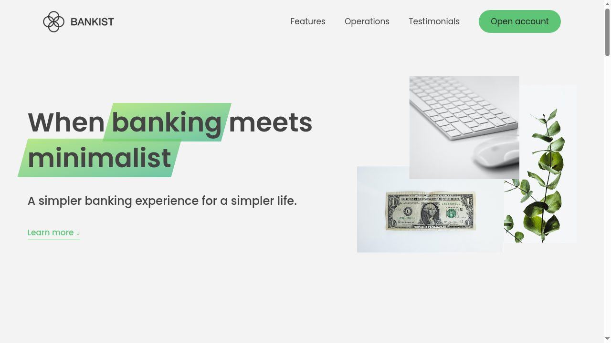

# Bankist - Landing Page

The marketing page of a fictional bank: smooth scrolling, a sticky header, tabbed features, a testimonial slider and lazy-loaded images. This is only the landing page; the banking app itself is in [Bankist-Project](https://github.com/mhmd7710d/Bankist-Project).

**See it:** https://mhmd7710d.github.io/UI-for-Bank-Site-/

## What you can try
- Scroll down: each section fades in and the navigation stays on top.
- Click the Features and Operations tabs to switch the content.
- Move through the testimonial slider with the arrow buttons.

## Built with
HTML, CSS and vanilla JavaScript. Intersection Observer for the scroll effects, native lazy loading for the images.

## What I practised
DOM selection and events, the Intersection Observer API, tab and slider logic, and CSS transitions.

## Run it locally
Download the repository and open `index.html` in a browser.

## Credits
Original project from Jonas Schmedtmann's Complete JavaScript Course, all copyright to Jonas Schmedtmann. Personalized by Muhammad Fathi.

## Contact
- LinkedIn: https://www.linkedin.com/in/muhammad-fathi-b7a693424/
- X (Twitter): https://x.com/mouahid7710
- Facebook: https://www.facebook.com/share/1CQhxpCeYL/
- Instagram: https://www.instagram.com/mhmd7710d/
- Email: muhammutfathi@gmail.com
- WhatsApp: https://wa.me/201040428475?text=Hi+Muhammad%2C+I+found+your+project+on+GitHub.
